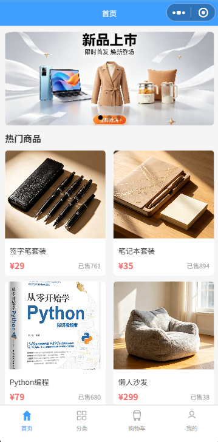
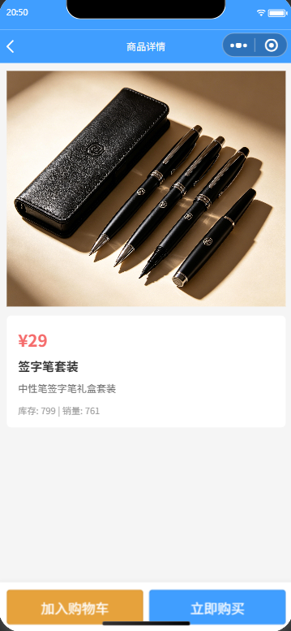
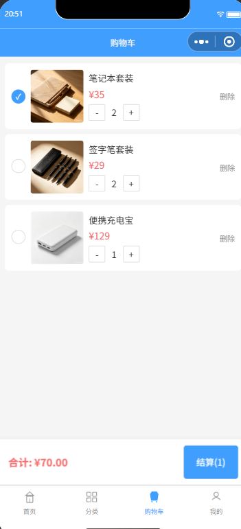
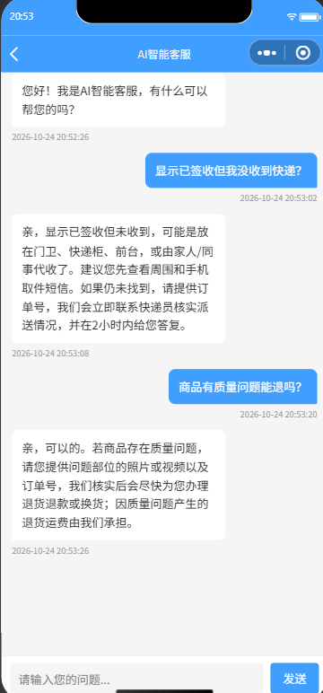
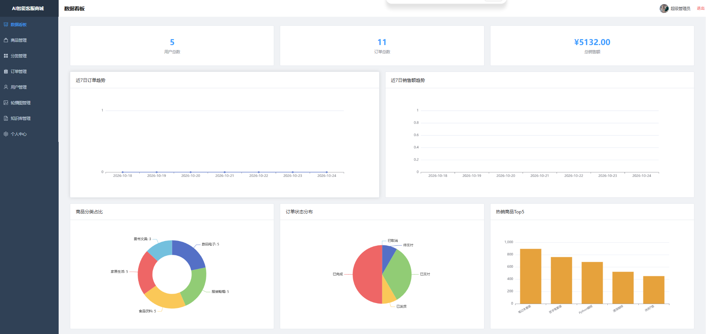
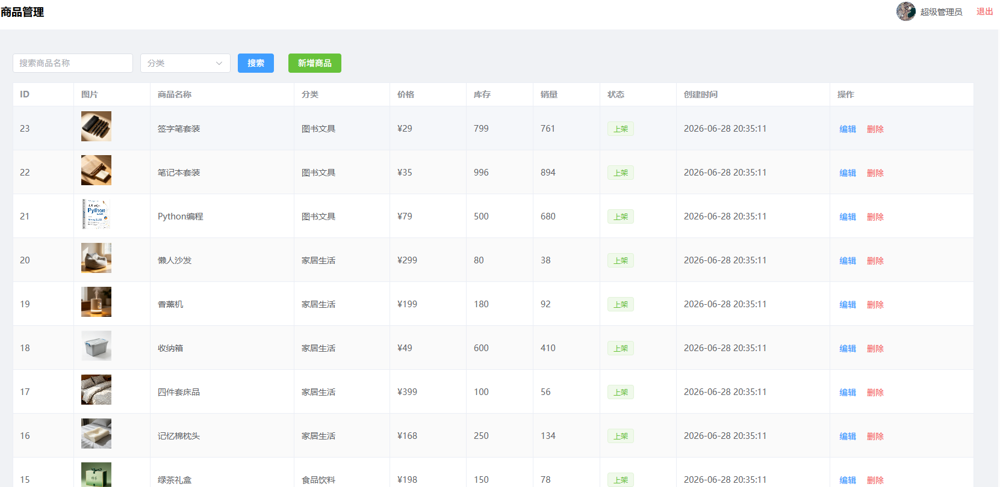
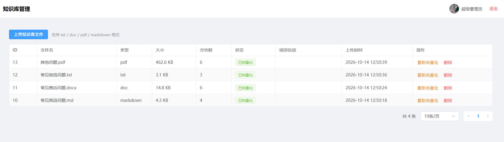

# 基于 LangChain 的带 AI 智能客服的微信小程序商城

- 基于 LangChain + Chroma 搭建 RAG 流程：知识库文件解析、分块、向量化、Top-K 检索后注入 Prompt，对接阿里云百炼 Qwen，小程序侧按会话保存问答记录
- 管理端支持 txt / doc / pdf / markdown 上传后自动解析并写入向量库，可按文件重新向量化或删除，实现知识库与问答同步更新
- 用户端与管理端共用 JWT，按 `type` 区分身份；下单时校验库存、生成订单号、写入明细并扣减库存，支付后回写销量

**技术栈：** FastAPI、LangChain、Chroma、Vue3、微信小程序、MySQL、JWT、ECharts

管理后台另用 Vite、Pinia、Element Plus；向量检索使用阿里云百炼 Embedding，对话模型为 Qwen。

## 功能

**微信小程序**

- 账号注册 / 登录、个人资料与头像
- 首页轮播、分类浏览、商品详情
- 购物车、地址管理、下单支付、订单列表
- AI 客服：按会话提问，答案来自知识库检索 + 大模型

**管理后台**

- 数据看板（ECharts）：用户数、订单数、销售额，近 7 日趋势、分类占比、订单状态、热销 Top5
- 商品、分类、轮播图、订单、用户管理
- 知识库：上传 txt / doc / pdf / markdown，自动解析并向量化，支持重新向量化与删除

**后端**

- 用户 / 管理员共用 JWT，按 `type` 区分身份
- 下单校验库存、生成订单号、写入明细并扣减库存，支付后回写销量
- RAG：文件解析 → 分块 → 向量化 → Top-K 检索 → 注入 Prompt → Qwen 问答

## 界面预览

**微信小程序**

| 首页 | 商品详情 |
|---|---|
|  |  |
| **购物车** | **智能客服** |
|  |  |

**管理后台**

| 数据看板 | 商品管理 | 知识库管理 |
|---|---|---|
|  |  |  |

## 目录

```text
SmartShop/
├── weixin/                 微信小程序
├── client/                 Vue3 管理后台
├── server/                 FastAPI 后端
│   ├── routers/            接口
│   ├── models/             ORM
│   ├── services/           RAG、向量库、文件解析
│   ├── sql/db_ai_shop.sql  建库脚本（含演示数据）
│   └── requirements.txt
├── uploads14/              图片与知识库文件
├── img/                    界面截图
└── 知识库测试文件/          可直接上传的示例文档
```

## 环境要求

先装好这些，并保证 MySQL 已启动：

- Python 3.10+
- Node.js 18+
- MySQL 8（默认按账号 `root`、密码 `123456`、端口 `3306`）
- 微信开发者工具（跑小程序时需要）

按下面 1～4 做完后，管理后台和小程序模拟器就可以登录、浏览商品、下单。AI 客服见第 5 步，不配也能先跑商城。

## 启动

在项目根目录 `SmartShop` 下操作。下面命令按 **Windows PowerShell** 写；Git Bash 里把 `$env:NAME="value"` 换成 `export NAME=value`。

### 1. 导入数据库

若 MySQL 密码不是 `123456`，先改 `server/config.py` 里的 `DATABASE_URL`。

**Git Bash / CMD：**

```bash
mysql -u root -p --default-character-set=utf8mb4 < server/sql/db_ai_shop.sql
```

**PowerShell：**

```powershell
Get-Content server/sql/db_ai_shop.sql -Encoding UTF8 | mysql -u root -p --default-character-set=utf8mb4
```

也可以打开 MySQL 客户端，执行 `server/sql/db_ai_shop.sql`。脚本会创建库 `db_ai_shop` 并写入演示数据。

### 2. 启动后端

```powershell
cd server
pip install -r requirements.txt
python -m uvicorn main:app --host 0.0.0.0 --port 8000 --reload
```

日志出现 `Uvicorn running on http://0.0.0.0:8000` 即成功。浏览器打开：

- http://127.0.0.1:8000/docs
- http://127.0.0.1:8000/api/health

这个窗口保持运行，再开一个终端做后面的步骤。

### 3. 启动管理后台

```powershell
cd client
npm install
npm run dev
```

浏览器打开 http://127.0.0.1:5173

- 账号：`admin`
- 密码：`12345678`

能进入数据看板、商品列表即后台已通。

### 4. 打开微信小程序

1. 用微信开发者工具导入项目，目录选 `weixin/`
2. 右上角 **详情 → 本地设置**，勾选「不校验合法域名、web-view、TLS 版本以及 HTTPS 证书」
3. 用模拟器编译运行（默认请求 `http://127.0.0.1:8000`，不用改代码）

演示账号：`user001` / `123456`，也可以在登录页注册。

至此商城可以浏览、加购、下单。支付是模拟接口。

### 5. 启用 AI 客服（可选）

1. 申请阿里云百炼 API Key，兼容接口地址默认是 `https://dashscope.aliyuncs.com/compatible-mode/v1`
2. 停掉后端，在启动前设置环境变量后再启动：

```powershell
cd server
$env:OPENAI_API_KEY="你的百炼Key"
python -m uvicorn main:app --host 0.0.0.0 --port 8000 --reload
```

3. 用管理员登录管理后台，打开「知识库管理」，上传 `知识库测试文件/` 里的文档（支持 txt / doc / pdf / markdown），等状态变为已向量化
4. 小程序进入「AI 客服」即可提问

模型配置在 `server/config.py`：对话 `qwen3.8-max`，Embedding `text-embedding-v4`，分块 500 / 重叠 50，检索 Top-4。向量数据在 `server/chroma_db/`，上传文件在项目根目录 `uploads14/`。

### 6. 真机调试（可选）

模拟器不需要这一步。

1. 把 `weixin/utils/request.js` 中的 `DEVICE_HOST` 改成电脑 WLAN 的 IPv4
2. 手机和电脑连同一 Wi-Fi，后端保持 `--host 0.0.0.0`
3. 开发者工具用「真机调试」；基础库建议选 **3.8.6**（更高版本真机不加载 http 图片）

## RAG 流程

```text
后台上传文档
    → 解析 txt / doc / pdf / markdown
    → 按 500/50 分块
    → Embedding 写入 Chroma
用户提问
    → 相似度检索 Top-4
    → 写入 Prompt
    → Qwen 生成回答
    → 按 session_id 写入 t_chat_message
```

## 主要接口

| 模块 | 前缀 | 说明 |
|---|---|---|
| 认证 | `/api/auth` | 管理员登录，用户登录 / 注册 |
| 商品 / 分类 / 轮播 | `/api/product` `/api/category` `/api/banner` | 前台查询 + 后台维护 |
| 购物车 / 地址 / 订单 | `/api/cart` `/api/address` `/api/order` | 用户下单与模拟支付 |
| 客服 | `/api/chat` | 发送消息、会话历史 |
| 知识库 | `/api/knowledge` | 上传、向量化、删除（管理员） |
| 看板 | `/api/dashboard` | 统计数据（管理员） |
| 上传 | `/api/upload` | 图片、头像 |
| 静态文件 | `/uploads` | 商品图、轮播图、头像、知识库文件 |

完整定义见 http://127.0.0.1:8000/docs。

## 说明

- 支付是模拟接口，没有对接微信 / 支付宝
- 登录是账号密码，不是微信 `code` 登录
- RAG 按当前问题检索，历史消息会落库，但不会拼进下一轮 Prompt
- 知识库向量化在上传请求里同步完成
